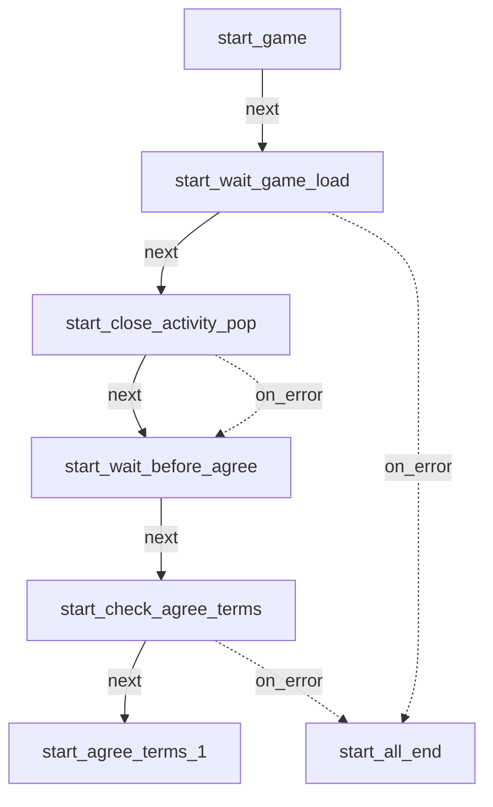
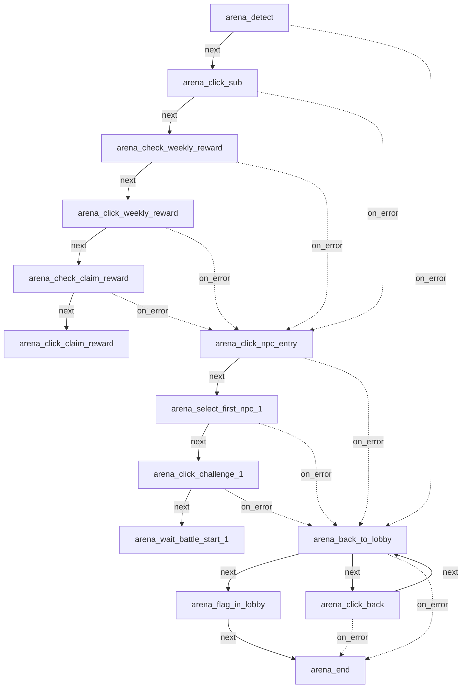
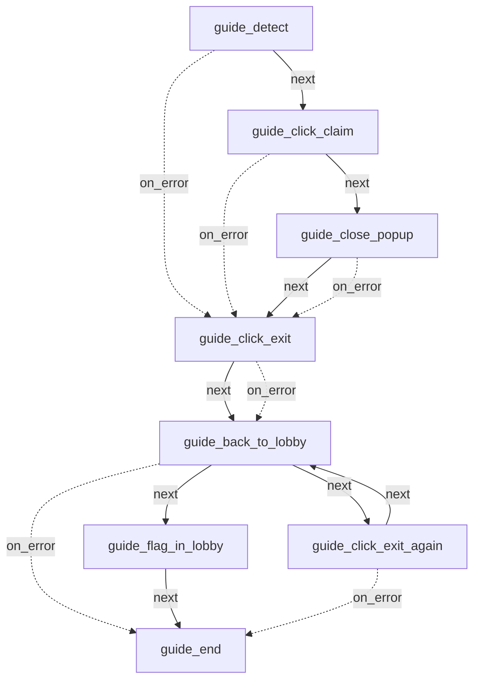
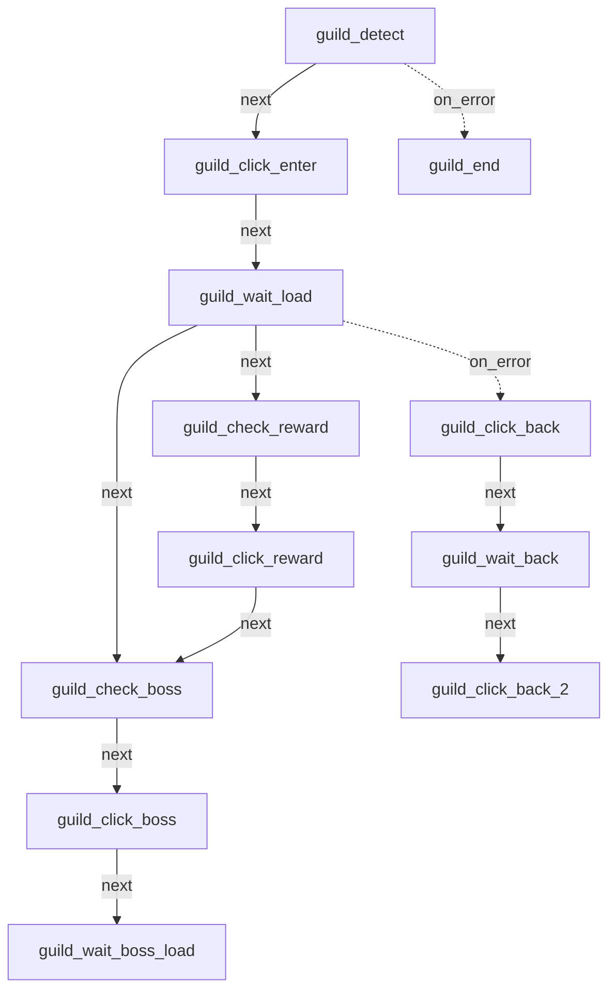
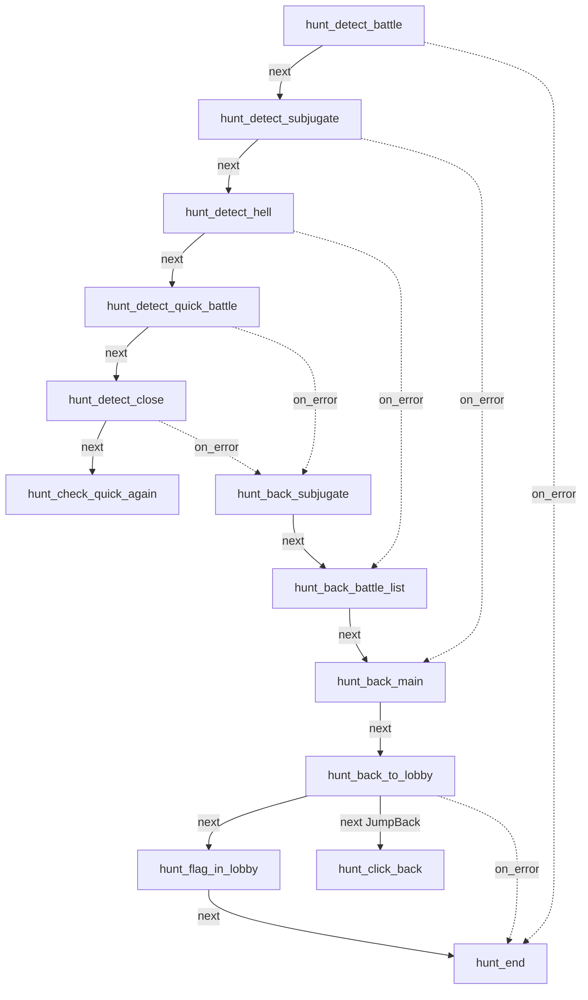
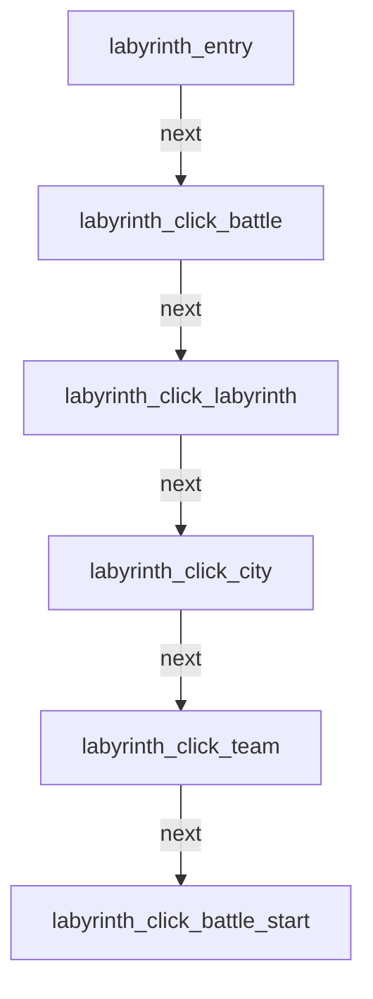
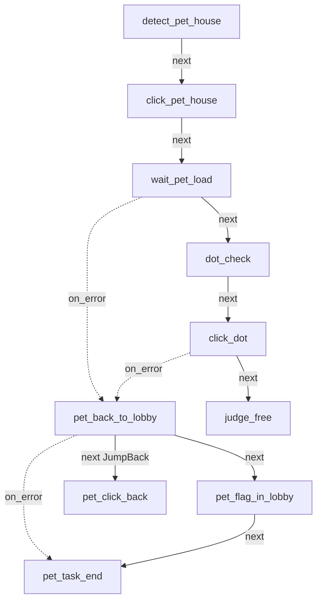
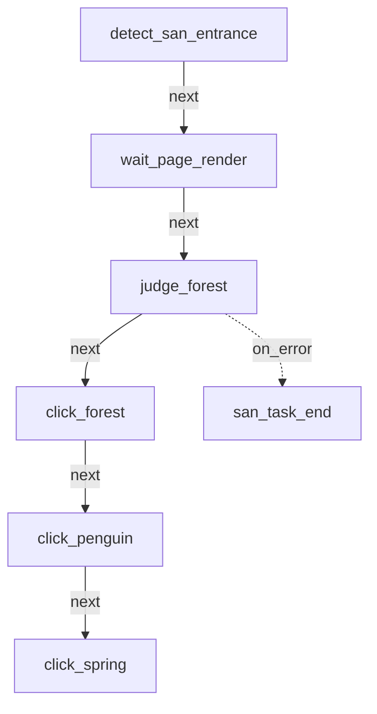
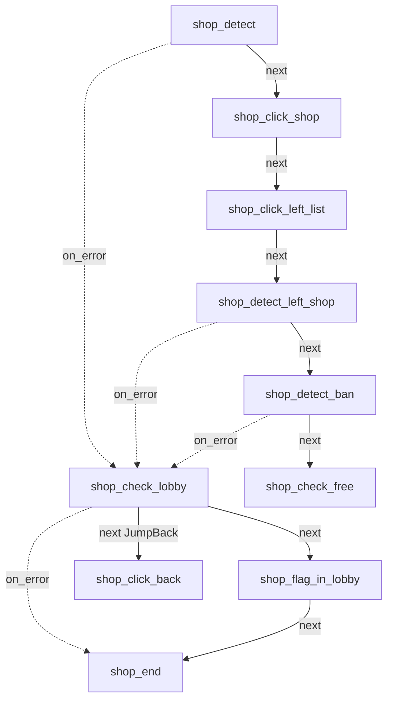
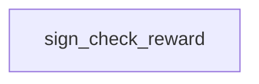

# Basic Info

> Auto-generated by `maa-project-init`. Review TODO items before relying on this file for automation edits.

## 0. Maa Skills 接力协议

`basic_info.md` 是项目上下文缓存，不是 Pipeline 源文件。Maa skills 应先读本节，再按任务读取相关章节，并始终以当前源码和实时设备结果为准。

| Consumer skill | Read first | Must re-verify |
| --- | --- | --- |
| maa-pipeline-guide / maa-pipeline-generate | 3, 4, 5, 7, 8, 9 | 待修改节点及目标页面 |
| maa-pipeline-graph | 2, 3, 6 | 跨文件边、Python 调用和 interface entry |
| maa-pipeline-option | 1, 2, 6 | pipeline_override 与 Python 读取路径 |
| maa-pipeline-testing | 2, 5, 7, 8, 9, 10 | 当前截图、OCR 命中和高风险动作 |

- 若本文件缺失，且当前会话可用 `maa-project-init`，先运行它。
- 若本文件早于相关 Pipeline / interface / agent 文件，视为可能过期；先重跑摘要，不要静默覆盖本文件。
- 发现源码或实机结果与本文冲突时，记录冲突并采用新证据；未经确认不要覆盖已有非空文件。

## 1. 项目概览

- 项目名: `maae7`
- 根目录: `G:\maae7`
- 仓库/主页: https://github.com/zx112266/maae7
- interface: `assets/interface.json`
- 控制器: Adb, Win32
- Agent: `{}`

## 2. 资源组与入口任务

### Resource groups
| Name | Paths | Existing paths |
| --- | --- | --- |
| 官服 | ./resource | 1 |
| B 服 | ./resource | 1 |

### Agent script paths

> 接口声明的 agent 入口文件静态扫描结果；只读、不修改 interface.json。

_No agent block / child_args detected._

### Task entries
| Task | Entry | Repeatable |
| --- | --- | --- |
| 启动游戏 | start_game | false |
| 竞技场自动战斗 | arena_detect | false |
| 欧勒毕斯指南领取奖励 | guide_detect | false |
| 骑士团世界首领战 | guild_detect | false |
| 讨伐地狱级快速战斗 | hunt_detect_battle | false |
| 迷宫商人购买强化石 | labyrinth_entry | false |
| 宠物小屋领养宠物 | detect_pet_house | false |
| 圣域精灵之森照料 | detect_san_entrance | false |
| 商店领取免费物资 | shop_detect | false |
| 关闭签到及各类弹窗 | sign_check_reward | false |

## 3. 主要 Pipeline

- Pipeline 文件数: 10
- 默认配置文件: None detected
- 唯一节点数: 207
- 节点定义数: 207

| File | Nodes |
| --- | --- |
| assets/resource/pipeline/arena.json | 49 |
| assets/resource/pipeline/labyrinth.json | 40 |
| assets/resource/pipeline/guild.json | 36 |
| assets/resource/pipeline/shop.json | 17 |
| assets/resource/pipeline/hunt.json | 14 |
| assets/resource/pipeline/pet_house.json | 14 |
| assets/resource/pipeline/sanctuary.json | 14 |
| assets/resource/pipeline/start.json | 9 |
| assets/resource/pipeline/guide_reward.json | 8 |
| assets/resource/pipeline/sign_reward.json | 6 |

### 入口主链路流程图

从 `interface.json` 的 task entry 出发，按 `next/on_error/interrupt` 展开有限深度流程图；公共返回、确认、退出节点会自然出现在图中。

#### 启动游戏 (`start_game`)

- 入口节点存在: True
- 主路径: `start_game -> start_wait_game_load -> start_close_activity_pop -> start_wait_before_agree -> start_check_agree_terms -> start_agree_terms_1 -> start_agree_terms_2 -> start_agree_terms_3 -> start_all_end`
- 图规模: 7 nodes / 8 edges，已截断
- 未解析引用: None detected

#### 竞技场自动战斗 (`arena_detect`)

- 入口节点存在: True
- 主路径: `arena_detect -> arena_click_sub -> arena_check_weekly_reward -> arena_click_weekly_reward -> arena_check_claim_reward -> arena_click_claim_reward -> arena_close_reward_1 -> arena_close_reward_2 -> arena_close_reward_3 -> arena_click_npc_entry -> arena_select_first_npc_1 -> arena_click_challenge_1`
- 图规模: 14 nodes / 22 edges，已截断
- 未解析引用: None detected

#### 欧勒毕斯指南领取奖励 (`guide_detect`)

- 入口节点存在: True
- 主路径: `guide_detect -> guide_click_claim -> guide_close_popup -> guide_click_exit -> guide_back_to_lobby -> guide_flag_in_lobby -> guide_end`
- 图规模: 8 nodes / 14 edges
- 未解析引用: None detected

#### 骑士团世界首领战 (`guild_detect`)

- 入口节点存在: True
- 主路径: `guild_detect -> guild_click_enter -> guild_wait_load -> guild_check_reward -> guild_click_reward -> guild_check_boss -> guild_click_boss -> guild_wait_boss_load -> guild_check_count -> guild_click_team -> guild_wait_team_1 -> guild_check_form_team`
- 图规模: 12 nodes / 12 edges，已截断
- 未解析引用: None detected

#### 讨伐地狱级快速战斗 (`hunt_detect_battle`)

- 入口节点存在: True
- 主路径: `hunt_detect_battle -> hunt_detect_subjugate -> hunt_detect_hell -> hunt_detect_quick_battle -> hunt_detect_close -> hunt_check_quick_again -> hunt_detect_close_again -> hunt_back_subjugate -> hunt_back_battle_list -> hunt_back_main -> hunt_back_to_lobby -> hunt_flag_in_lobby`
- 图规模: 13 nodes / 17 edges，已截断
- 未解析引用: None detected

#### 迷宫商人购买强化石 (`labyrinth_entry`)

- 入口节点存在: True
- 主路径: `labyrinth_entry -> labyrinth_click_battle -> labyrinth_click_labyrinth -> labyrinth_click_city -> labyrinth_click_team -> labyrinth_click_battle_start -> labyrinth_click_47 -> labyrinth_click_teleport1 -> labyrinth_confirm_teleport -> labyrinth_click_44 -> labyrinth_click_teleport2 -> labyrinth_confirm_teleport2`
- 图规模: 6 nodes / 5 edges，已截断
- 未解析引用: None detected

#### 宠物小屋领养宠物 (`detect_pet_house`)

- 入口节点存在: True
- 主路径: `detect_pet_house -> click_pet_house -> wait_pet_load -> dot_check -> click_dot -> judge_free -> click_free -> judge_result -> click_blank -> pet_back_to_lobby -> pet_flag_in_lobby -> pet_task_end`
- 图规模: 10 nodes / 11 edges，已截断
- 未解析引用: None detected

#### 圣域精灵之森照料 (`detect_san_entrance`)

- 入口节点存在: True
- 主路径: `detect_san_entrance -> wait_page_render -> judge_forest -> click_forest -> click_penguin -> click_spring -> click_plant -> click_care -> click_plant_area -> click_back -> wait_after_back -> judge_back`
- 图规模: 7 nodes / 6 edges，已截断
- 未解析引用: None detected

#### 商店领取免费物资 (`shop_detect`)

- 入口节点存在: True
- 主路径: `shop_detect -> shop_click_shop -> shop_click_left_list -> shop_detect_left_shop -> shop_detect_ban -> shop_check_free -> shop_click_free -> shop_wait_purchase_confirm -> shop_check_purchase -> shop_click_purchase -> shop_wait_reward -> shop_check_close`
- 图规模: 10 nodes / 12 edges，已截断
- 未解析引用: None detected

#### 关闭签到及各类弹窗 (`sign_check_reward`)

- 入口节点存在: False
- 主路径: `sign_check_reward -> (missing entry)`
- 图规模: 1 nodes / 0 edges
- 未解析引用: None detected

## 4. 公共基础节点

这些节点通常被多条链路引用，或名称/行为显示它们是通用 UI 控制节点。

| Node | In | Recognition | Action | Categories |
| --- | --- | --- | --- | --- |
| arena_back_to_lobby | 34 | DirectHit | DoNothing | common-ui, high-in-degree, return-exit |
| arena_click_npc_entry | 9 | OCR | Click | high-in-degree |
| guild_click_back | 7 | DirectHit | Click | common-ui, high-in-degree, return-exit |
| shop_check_lobby | 7 | <default> | <default> | common-ui, high-in-degree |
| labyrinth_check_buy_dialog | 6 | OCR | <default> | common-ui, high-in-degree |
| labyrinth_check_items_phase1 | 6 | <default> | <default> | common-ui, high-in-degree |
| hunt_back_subjugate | 5 | DirectHit | Click | common-ui, high-in-degree, return-exit |
| pet_back_to_lobby | 5 | <default> | <default> | common-ui, high-in-degree, return-exit |
| guide_click_exit | 4 | DirectHit | Click | common-ui, return-exit |
| guide_back_to_lobby | 3 | DirectHit | DoNothing | common-ui, return-exit |
| labyrinth_exit_step1 | 3 | TemplateMatch | Click | common-ui, return-exit, template-control |
| start_all_end | 3 | DirectHit | DoNothing | common-ui |
| arena_click_confirm_battle_1 | 2 | DirectHit | Click | common-ui, confirm-cancel |
| arena_click_confirm_battle_2 | 2 | DirectHit | Click | common-ui, confirm-cancel |
| arena_click_confirm_battle_3 | 2 | DirectHit | Click | common-ui, confirm-cancel |
| arena_click_confirm_battle_4 | 2 | DirectHit | Click | common-ui, confirm-cancel |
| arena_click_confirm_battle_5 | 2 | DirectHit | Click | common-ui, confirm-cancel |
| guild_check_boss | 2 | OCR | <default> | common-ui |
| guild_check_confirm_1 | 2 | OCR | <default> | common-ui, confirm-cancel |
| guild_check_count | 2 | OCR | <default> | common-ui |
| guild_check_one | 2 | OCR | <default> | common-ui |
| guild_check_zero | 2 | OCR | <default> | common-ui |
| guild_wait_result | 2 | DirectHit | DoNothing | common-ui |
| hunt_back_battle_list | 2 | DirectHit | Click | common-ui, return-exit |
| hunt_back_main | 2 | DirectHit | Click | common-ui, return-exit |
| labyrinth_check_items_phase2 | 2 | <default> | <default> | common-ui |
| sign_check_buff | 2 | OCR | <default> | common-ui |
| start_wait_before_agree | 2 | DirectHit | DoNothing | common-ui |
| arena_check_claim_reward | 1 | OCR | DoNothing | common-ui |
| arena_check_weekly_reward | 1 | OCR | DoNothing | common-ui |

## 5. 返回 / 退出 / 弹窗处理

重点关注返回、退出、关闭、确认、重连、体力不足等流程。MaaGumballs 一类项目常通过 `[JumpBack]` 把这些节点挂到主链路中。

| Node | In | Recognition | Action | Files |
| --- | --- | --- | --- | --- |
| arena_back_to_lobby | 34 | DirectHit | DoNothing | assets/resource/pipeline/arena.json |
| guild_click_back | 7 | DirectHit | Click | assets/resource/pipeline/guild.json |
| hunt_back_subjugate | 5 | DirectHit | Click | assets/resource/pipeline/hunt.json |
| pet_back_to_lobby | 5 | <default> | <default> | assets/resource/pipeline/pet_house.json |
| guide_click_exit | 4 | DirectHit | Click | assets/resource/pipeline/guide_reward.json |
| guide_back_to_lobby | 3 | DirectHit | DoNothing | assets/resource/pipeline/guide_reward.json |
| labyrinth_exit_step1 | 3 | TemplateMatch | Click | assets/resource/pipeline/labyrinth.json |
| hunt_back_battle_list | 2 | DirectHit | Click | assets/resource/pipeline/hunt.json |
| hunt_back_main | 2 | DirectHit | Click | assets/resource/pipeline/hunt.json |
| arena_click_back | 1 | TemplateMatch | Click | assets/resource/pipeline/arena.json |
| arena_close_reward_1 | 1 | DirectHit | Click | assets/resource/pipeline/arena.json |
| arena_close_reward_2 | 1 | DirectHit | Click | assets/resource/pipeline/arena.json |
| arena_close_reward_3 | 1 | DirectHit | Click | assets/resource/pipeline/arena.json |
| click_back | 1 | DirectHit | Click | assets/resource/pipeline/sanctuary.json |
| click_back_again | 1 | DirectHit | Click | assets/resource/pipeline/sanctuary.json |
| guide_click_exit_again | 1 | DirectHit | Click | assets/resource/pipeline/guide_reward.json |
| guide_close_popup | 1 | OCR | Click | assets/resource/pipeline/guide_reward.json |
| guild_click_back_2 | 1 | DirectHit | Click | assets/resource/pipeline/guild.json |
| guild_wait_back | 1 | DirectHit | DoNothing | assets/resource/pipeline/guild.json |
| guild_wait_return | 1 | DirectHit | DoNothing | assets/resource/pipeline/guild.json |
| hunt_back_to_lobby | 1 | <default> | <default> | assets/resource/pipeline/hunt.json |
| hunt_click_back | 1 | TemplateMatch | Click | assets/resource/pipeline/hunt.json |
| hunt_detect_close | 1 | OCR | Click | assets/resource/pipeline/hunt.json |
| hunt_detect_close_again | 1 | OCR | Click | assets/resource/pipeline/hunt.json |
| judge_back | 1 | OCR | <default> | assets/resource/pipeline/sanctuary.json |
| labyrinth_back_to_lobby | 1 | <default> | <default> | assets/resource/pipeline/labyrinth.json |
| labyrinth_click_back | 1 | TemplateMatch | Click | assets/resource/pipeline/labyrinth.json |
| labyrinth_exit_step2 | 1 | DirectHit | Click | assets/resource/pipeline/labyrinth.json |
| labyrinth_exit_step3 | 1 | OCR | Click | assets/resource/pipeline/labyrinth.json |
| labyrinth_exit_step4 | 1 | OCR | Click | assets/resource/pipeline/labyrinth.json |

### Confirm / Cancel nodes
| Node | In | Recognition | Action |
| --- | --- | --- | --- |
| arena_click_confirm_battle_1 | 2 | DirectHit | Click |
| arena_click_confirm_battle_2 | 2 | DirectHit | Click |
| arena_click_confirm_battle_3 | 2 | DirectHit | Click |
| arena_click_confirm_battle_4 | 2 | DirectHit | Click |
| arena_click_confirm_battle_5 | 2 | DirectHit | Click |
| guild_check_confirm_1 | 2 | OCR | <default> |
| guild_check_confirm_2 | 1 | OCR | <default> |
| guild_click_confirm_1 | 1 | DirectHit | Click |
| guild_click_confirm_2 | 1 | DirectHit | Click |
| labyrinth_confirm_buy | 1 | DirectHit | Click |
| labyrinth_confirm_teleport | 1 | OCR | Click |
| labyrinth_confirm_teleport2 | 1 | OCR | Click |
| shop_wait_purchase_confirm | 1 | DirectHit | DoNothing |
| sign_click_cancel | 1 | DirectHit | Click |
| no_dot_click | 0 | DirectHit | Click |
| sign_check_confirm | 0 | OCR | Click |

## 6. 节点关系摘要

- 边数量: 309
- 边类型: `{"next": 217, "on_error": 92}`
- 跨文件引用数: 0
- 未解析引用数: 0
- 未声明 anchor 引用数: 0
- anchor 目标缺失数: 0
- 孤立节点数: 0
- 重复节点名数: 0
- 跨 bundle 覆盖节点名数: 0
- 疑似循环/SCC 数: 5

### Top in-degree nodes
| Node | In |
| --- | --- |
| arena_back_to_lobby | 34 |
| arena_click_npc_entry | 9 |
| guild_click_back | 7 |
| shop_check_lobby | 7 |
| labyrinth_check_items_phase1 | 6 |
| labyrinth_check_buy_dialog | 6 |
| hunt_back_subjugate | 5 |
| pet_back_to_lobby | 5 |
| guide_click_exit | 4 |
| arena_end | 3 |
| guide_back_to_lobby | 3 |
| guide_end | 3 |
| hunt_end | 3 |
| labyrinth_scroll_items | 3 |
| labyrinth_exit_step1 | 3 |
| san_task_end | 3 |
| start_all_end | 3 |
| arena_click_confirm_battle_1 | 2 |
| arena_click_confirm_battle_2 | 2 |
| arena_click_confirm_battle_3 | 2 |
| arena_click_confirm_battle_4 | 2 |
| arena_click_confirm_battle_5 | 2 |
| guild_end | 2 |
| guild_check_boss | 2 |
| guild_check_count | 2 |

### Python / interface 外部入口

- 扫描 Python 文件数: 3
- 静态 Python Pipeline 调用数: 1
- 动态目标调用数: 0
- 外部入口命中节点数: 9
- 排除外部入口后的无入边候选数: 2

| Kind | Target | Calls | Sample call site |
| --- | --- | --- | --- |
| run_recognition | RecognizeNumber | 1 | SmallestNumberRecognition.analyze @ agent/my_reco.py:28 |

## 7. OCR 文字识别约定

以下为扫描到的 `expected` 样例。请人工补充 OCR 易错字、替换规则和跨语言差异。

| Node | Expected | ROI | File |
| --- | --- | --- | --- |
| arena_detect | ["竞技场"] | [1161, 368, 83, 40] | assets/resource/pipeline/arena.json |
| arena_click_sub | ["竞技场"] | [423, 650, 96, 40] | assets/resource/pipeline/arena.json |
| arena_check_weekly_reward | ["每周排名选择奖励"] | [507, 147, 266, 70] | assets/resource/pipeline/arena.json |
| arena_check_claim_reward | ["领取选择的奖励"] | [562, 513, 156, 38] | assets/resource/pipeline/arena.json |
| arena_click_npc_entry | ["NPC对战"] | [1000, 180, 200, 80] | assets/resource/pipeline/arena.json |
| arena_wait_battle_start_1 | ["战斗开始"] | [700, 600, 250, 100] | assets/resource/pipeline/arena.json |
| arena_wait_reward_1 | ["确认"] | [1100, 600, 150, 100] | assets/resource/pipeline/arena.json |
| arena_wait_battle_start_2 | ["战斗开始"] | [700, 600, 250, 100] | assets/resource/pipeline/arena.json |
| arena_wait_reward_2 | ["确认"] | [1100, 600, 150, 100] | assets/resource/pipeline/arena.json |
| arena_wait_battle_start_3 | ["战斗开始"] | [700, 600, 250, 100] | assets/resource/pipeline/arena.json |
| arena_wait_reward_3 | ["确认"] | [1100, 600, 150, 100] | assets/resource/pipeline/arena.json |
| arena_wait_battle_start_4 | ["战斗开始"] | [700, 600, 250, 100] | assets/resource/pipeline/arena.json |
| arena_wait_reward_4 | ["确认"] | [1100, 600, 150, 100] | assets/resource/pipeline/arena.json |
| arena_wait_battle_start_5 | ["战斗开始"] | [700, 600, 250, 100] | assets/resource/pipeline/arena.json |
| arena_wait_reward_5 | ["确认"] | [1100, 600, 150, 100] | assets/resource/pipeline/arena.json |
| arena_flag_in_lobby | ["竞技场"] | [1161, 371, 87, 39] | assets/resource/pipeline/arena.json |
| guide_detect | ["欧勒毕斯指南"] | [938, 666, 96, 31] | assets/resource/pipeline/guide_reward.json |
| guide_click_claim | ["欧勒毕斯指南"] | [61, 59, 181, 46] | assets/resource/pipeline/guide_reward.json |
| guide_close_popup | ["点击关闭"] | [590, 509, 102, 41] | assets/resource/pipeline/guide_reward.json |
| guide_flag_in_lobby | ["竞技场"] | [1161, 371, 87, 39] | assets/resource/pipeline/guide_reward.json |
| guild_detect | ["骑士团"] | [870, 668, 54, 24] | assets/resource/pipeline/guild.json |
| guild_check_reward | ["获得奖励"] | [577, 147, 127, 43] | assets/resource/pipeline/guild.json |
| guild_check_boss | ["世界首领战"] | [245, 446, 96, 22] | assets/resource/pipeline/guild.json |
| guild_check_count | ["2"] | [1058, 651, 18, 29] | assets/resource/pipeline/guild.json |
| guild_check_one | ["1"] | [1058, 651, 18, 29] | assets/resource/pipeline/guild.json |
| guild_check_form_team | ["组成战斗队伍"] | [1016, 636, 145, 41] | assets/resource/pipeline/guild.json |
| guild_check_auto_config | ["自动配置"] | [110, 637, 101, 36] | assets/resource/pipeline/guild.json |
| guild_check_battle_start | ["战斗开始"] | [868, 634, 95, 45] | assets/resource/pipeline/guild.json |
| guild_check_skip | ["跳过"] | [1052, 17, 49, 31] | assets/resource/pipeline/guild.json |
| guild_check_all_on | ["全部开启"] | [584, 606, 108, 41] | assets/resource/pipeline/guild.json |
| guild_check_confirm_1 | ["确认"] | [584, 606, 108, 41] | assets/resource/pipeline/guild.json |
| guild_check_confirm_2 | ["确认"] | [1122, 641, 64, 35] | assets/resource/pipeline/guild.json |
| guild_check_zero | ["0"] | [1058, 651, 18, 29] | assets/resource/pipeline/guild.json |
| hunt_detect_battle | ["战斗"] | [1160, 290, 80, 50] | assets/resource/pipeline/hunt.json |
| hunt_detect_subjugate | ["讨伐"] | [0, 113, 1190, 195] | assets/resource/pipeline/hunt.json |
| hunt_detect_hell | ["讨伐地狱级"] | [750, 370, 130, 40] | assets/resource/pipeline/hunt.json |
| hunt_detect_quick_battle | ["快速战斗"] | [1060, 630, 120, 50] | assets/resource/pipeline/hunt.json |
| hunt_detect_close | ["关闭"] | [810, 525, 80, 50] | assets/resource/pipeline/hunt.json |
| hunt_check_quick_again | ["快速战斗"] | [1060, 630, 120, 50] | assets/resource/pipeline/hunt.json |
| hunt_detect_close_again | ["关闭"] | [810, 525, 80, 50] | assets/resource/pipeline/hunt.json |

## 8. TemplateMatch 图片模板

- 图片文件数: 4

### Image directories
| Directory | Count |
| --- | --- |
| resource/<root> | 2 |
| resource/sanctuary_main | 2 |

### TemplateMatch usage samples
| Node | Template | ROI | File |
| --- | --- | --- | --- |
| arena_click_back | ["back_button.png"] | [12, 9, 54, 49] | assets/resource/pipeline/arena.json |
| hunt_click_back | ["back_button.png"] | [12, 9, 54, 49] | assets/resource/pipeline/hunt.json |
| labyrinth_exit_step1 | ["back_button.png"] | [12, 9, 54, 49] | assets/resource/pipeline/labyrinth.json |
| labyrinth_click_back | ["back_button.png"] | [12, 9, 54, 49] | assets/resource/pipeline/labyrinth.json |
| dot_check | sanctuary_main/dot_forest.png | [772, 625, 40, 35] | assets/resource/pipeline/pet_house.json |
| pet_click_back | ["back_button.png"] | [12, 9, 54, 49] | assets/resource/pipeline/pet_house.json |
| detect_san_entrance | ["sanctuary_main/san_entrance.png"] | [0, 0, 1280, 720] | assets/resource/pipeline/sanctuary.json |

## 9. 分辨率与 ROI 约定

- MaaMCP ADB 默认按截图短边 720 归一化；横屏/竖屏通过截图宽高判断。
- Pipeline 中的 ROI 应结合项目实际截图基准确认，不要盲目从其他设备复制。
- TODO: 用一次实机 `screencap` 记录目标设备分辨率、方向、DPI 和常用页面 ROI。

| Node | ROI | File |
| --- | --- | --- |
| arena_detect | [1161, 368, 83, 40] | assets/resource/pipeline/arena.json |
| arena_click_sub | [423, 650, 96, 40] | assets/resource/pipeline/arena.json |
| arena_check_weekly_reward | [507, 147, 266, 70] | assets/resource/pipeline/arena.json |
| arena_check_claim_reward | [562, 513, 156, 38] | assets/resource/pipeline/arena.json |
| arena_click_npc_entry | [1000, 180, 200, 80] | assets/resource/pipeline/arena.json |
| arena_wait_battle_start_1 | [700, 600, 250, 100] | assets/resource/pipeline/arena.json |
| arena_wait_reward_1 | [1100, 600, 150, 100] | assets/resource/pipeline/arena.json |
| arena_wait_battle_start_2 | [700, 600, 250, 100] | assets/resource/pipeline/arena.json |
| arena_wait_reward_2 | [1100, 600, 150, 100] | assets/resource/pipeline/arena.json |
| arena_wait_battle_start_3 | [700, 600, 250, 100] | assets/resource/pipeline/arena.json |
| arena_wait_reward_3 | [1100, 600, 150, 100] | assets/resource/pipeline/arena.json |
| arena_wait_battle_start_4 | [700, 600, 250, 100] | assets/resource/pipeline/arena.json |
| arena_wait_reward_4 | [1100, 600, 150, 100] | assets/resource/pipeline/arena.json |
| arena_wait_battle_start_5 | [700, 600, 250, 100] | assets/resource/pipeline/arena.json |
| arena_wait_reward_5 | [1100, 600, 150, 100] | assets/resource/pipeline/arena.json |
| arena_flag_in_lobby | [1161, 371, 87, 39] | assets/resource/pipeline/arena.json |
| arena_click_back | [12, 9, 54, 49] | assets/resource/pipeline/arena.json |
| guide_detect | [938, 666, 96, 31] | assets/resource/pipeline/guide_reward.json |
| guide_click_claim | [61, 59, 181, 46] | assets/resource/pipeline/guide_reward.json |
| guide_close_popup | [590, 509, 102, 41] | assets/resource/pipeline/guide_reward.json |
| guide_flag_in_lobby | [1161, 371, 87, 39] | assets/resource/pipeline/guide_reward.json |
| guild_detect | [870, 668, 54, 24] | assets/resource/pipeline/guild.json |
| guild_check_reward | [577, 147, 127, 43] | assets/resource/pipeline/guild.json |
| guild_check_boss | [245, 446, 96, 22] | assets/resource/pipeline/guild.json |
| guild_check_count | [1058, 651, 18, 29] | assets/resource/pipeline/guild.json |
| guild_check_one | [1058, 651, 18, 29] | assets/resource/pipeline/guild.json |
| guild_check_form_team | [1016, 636, 145, 41] | assets/resource/pipeline/guild.json |
| guild_check_auto_config | [110, 637, 101, 36] | assets/resource/pipeline/guild.json |
| guild_check_battle_start | [868, 634, 95, 45] | assets/resource/pipeline/guild.json |
| guild_check_skip | [1052, 17, 49, 31] | assets/resource/pipeline/guild.json |

### MaaMCP 实机验证记录

- 当前状态: `static-scan-only`（生成器不会把未验证的截图猜测写成事实）。
- 记录格式: 时间、controller/device、截图尺寸与方向、页面证据、测试节点、score、是否执行动作。
- 同一次验证的 OCR 与截图必须确认来自稳定的同一页面；画面切换时分别记录，不能合并为永久事实。
- TODO: 使用 `DoNothing` 探针验证至少一个公共返回/确认节点，并保留 TaskDetail 结果。

## 10. 风险清单与待确认项

- 未解析引用: None detected
- 未声明的 anchor 引用: None detected
- 目标节点缺失的 anchor 声明样例: []
- 图内孤立节点样例: None detected
- 排除外部入口后的无入边候选: no_dot_click, sign_check_confirm
- Python 动态目标调用数: 0
- 外部入口未解析引用: RecognizeNumber, sign_check_reward
- 重复节点名样例: None detected
- 跨 bundle 覆盖样例: None detected
- 疑似循环样例: [["guild_battle_wait", "guild_check_all_on", "guild_check_auto_config", "guild_check_battle_s...
- Agent script paths unresolved: 0
- Agent script path orphan declarations: 0
- Agent script path unreferenced candidates: 0
- TODO: 人工确认哪些高入度节点是真公共节点，哪些只是历史遗留或渠道覆盖。
- TODO: 对关键入口任务跑一次 MaaMCP 实机截图/OCR，补充游戏首页、弹窗、返回路径。
